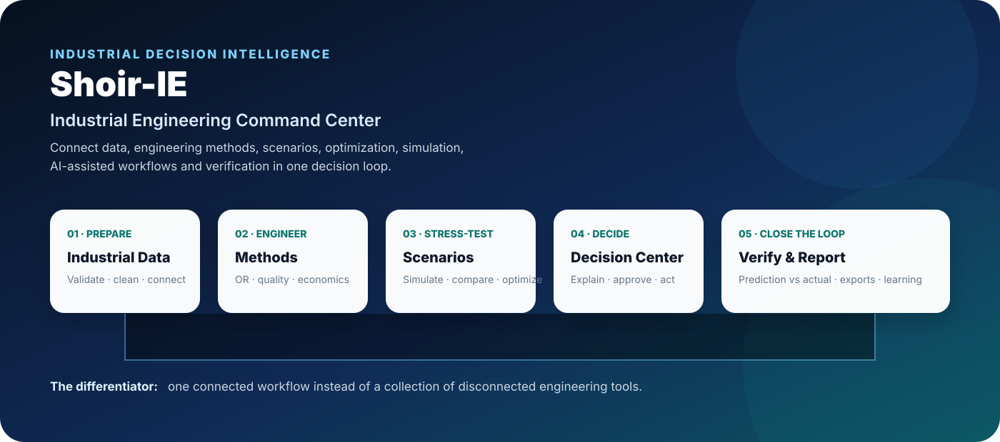

<div align="center">

# ⚡ Shoir-IE

### Industrial Engineering Operating System & Decision Intelligence

**Connect industrial data. Engineer better options. Test decisions. Verify outcomes.**

[](https://github.com/MSJ1708/shoir-ie/actions/workflows/shoir-validation.yml)
[](https://www.python.org/)
[](https://streamlit.io/)
[](LICENSE)

[**Open the live demo**](https://shoir-ie-app.streamlit.app/) · [Explore the code](https://github.com/MSJ1708/shoir-ie) · [Report an issue](https://github.com/MSJ1708/shoir-ie/issues)



</div>

---

## The problem Shoir-IE addresses

Industrial teams often move between spreadsheets, specialist engineering tools, planning systems, simulation models and presentation software to answer one operational question. Each hand-off can introduce duplicate work, inconsistent assumptions and a weaker audit trail.

**Shoir-IE is being built to connect that decision workflow in one industrial workspace.** It combines data preparation, engineering methods, optimization, simulation, scenario comparison and decision evidence around a shared workflow:

`DATA → VALIDATE → MAP → MODEL → RUN → VISUALIZE → COMPARE → EXPLAIN → DECIDE → EXPORT → VERIFY`

The ambition is not to win by counting the most modules. It is to make the path from source data to a defensible engineering decision more connected, repeatable and inspectable.

## What the platform brings together

| Work area | Example workflows |
|---|---|
| **Data & workbook** | Multi-sheet Excel/CSV import, cleaning, table alignment, data dictionaries, formula-oriented workbooks and structured exports |
| **Optimization & operations research** | Linear and mixed-integer optimization, network and assignment problems, allocation, sensitivity and multi-objective studies |
| **Production & planning** | Capacity and bottleneck analysis, planning and scheduling workflows, line balancing, inventory and recovery studies |
| **Quality & reliability** | SPC, process capability, Six Sigma, measurement and reliability-analysis workflows |
| **Facilities & warehousing** | Facility layout, from-to flow analysis, material handling and warehouse studies |
| **Simulation & forecasting** | Scenario analysis, uncertainty, forecasting and digital-twin / discrete-event foundations |
| **Maintenance & industrial operations** | Asset health, predictive-maintenance workflows, operational monitoring and loss analysis |
| **Economics & sustainability** | Engineering economics, investment comparisons, NPV/IRR/payback and environmental-impact workflows |
| **Digital Thread & decisions** | Connected assets, processes, products, materials, orders, KPIs, scenarios, decisions and outcomes |
| **Research & reproducibility** | Statistics, regression, experiment design, evidence tracking and research workflows |
| **Enterprise & collaboration** | Workspace persistence, role-aware navigation, connector health, knowledge and collaboration foundations |
| **Executive reporting** | Decision summaries and technical / executive exports, with evidence and assumption context where supported |

The application catalogue is the source of truth for what is currently surfaced. Availability depends on the selected plan, application state and deployment configuration. Integration foundations should not be interpreted as proof that every external connector is enabled or production-certified.

## Differentiated workflows

### ShadowShift — Micro-Loss & Recovery Intelligence

ShadowShift is designed to make repeated short interruptions visible when they disappear inside daily averages.

- Capture interruption events, duration, station, people affected, suspected cause and evidence strength.
- Keep interruption time separate from the time required to recover to stable work.
- Compare observed event burden and prioritize the next useful observation or experiment.
- Register a hypothesis and test, then retain an evidence-oriented export for review.

**Measurement discipline:** an observed event, a projection from an observation window, a scenario estimate and a verified saving are different things. ShadowShift is designed to keep those quantities distinct. A modeled exposure or recommended experiment is not, by itself, a realized financial benefit.

### Venture Studio — From industrial problem to investor evidence

Venture Studio supports the business-building loop around an industrial product or pilot:

`CUSTOMER → PILOT → HYPOTHESIS → EVIDENCE → VALUE / ROI → READINESS → TRACTION → INVESTOR ROOM → CASE STUDY`

Its intended workflow brings together customer and stakeholder context, pilot milestones, measurable hypotheses, ROI/value evidence, product readiness, traction and curated investor artifacts. The evidence chain is designed to support transparent customer-specific claims rather than unsupported universal savings promises.

### AKDT — Autonomous Kinetic-Digital Twin for Industrial Logistics Resilience

AKDT is positioned as an **Enterprise Plus scenario workflow** for exploring how disruptions can propagate through a connected logistics network. The intended workflow is to represent suppliers, routes, hand-offs, capacity limits and demand; stress-test assumptions such as route availability or lead time; compare alternatives; and record the evidence still needed before a plant-level decision.

Use synthetic inputs for demonstrations unless approved operational data is connected and validated. A scenario result is not a live autonomous controller, a guaranteed recovery plan, or proof of realized savings.

### Industrial decision and digital-thread workflow

The wider platform direction connects:

`Asset → Process → Product → Material → Order → Workforce → Quality → Maintenance → Energy → Cost → Scenario → Decision → Outcome`

Where the required source records are available, the goal is to trace a decision back to its assumptions, data and model, and to capture what happened after implementation. The depth of traceability depends on the configured workflow and source integrations.

## Illustrative flagship demonstration

The **72-Hour Factory Rescue** is a fictional Saudi manufacturing scenario created to demonstrate how an engineer might move from a plant-risk signal to a coordinated recovery plan. It is not a customer case study or a claim of achieved savings.

The demonstration links a production-risk situation to capacity recovery, asset-risk analysis, simulation, optimization, decision tracking and an ROI/evidence summary. It is intended to show the user journey and the platform's decision logic—not to substitute synthetic scenario values for plant measurements.

## How value should be measured

Shoir-IE encourages a baseline-first approach. Example formulas include:

- **Hours saved per study** = baseline study time − Shoir-IE study time
- **Annual capacity released** = hours saved per study × comparable studies per year
- **Verified economic benefit** = baseline cost − post-deployment cost − implementation cost

A credible customer result should identify the source, measurement window, assumptions, implementation cost, confidence or limitations, and who verified it. Estimates remain estimates until the before/after evidence supports the claim.

## Commercial plans

The in-app catalogue currently presents these indicative plan prices:

| Plan | Displayed price | Positioning |
|---|---:|---|
| Starter | $29 | Core industrial-engineering workflows |
| Mid-Tier Pro | $79 | Broader operational-improvement workflows |
| Professional | $129 | Advanced specialist engineering workflows |
| Enterprise | $199 | Connected decision and enterprise workflow foundations |
| Enterprise Plus | $399 | Expanded enterprise capabilities, including Enterprise Plus tier access |
| Research Pack | +$30 | Research-focused add-on |

Prices and entitlements should be confirmed in the running application before purchase. Tier availability is governed by application logic and is not a promise that every named capability is enabled in every deployment.

## Account lifecycle and data continuity

Paid subscriptions use a **30-day period from activation or approved renewal**. When the period expires, normal workspace access is paused instead of deleting the account.

The renewal workflow is designed to:
1. authenticate the existing account;
2. offer a short-lived, renewal-only session if the subscription has expired;
3. require a transaction/payment reference for a durable renewal-review trail, with an optional PNG/JPG/PDF receipt (up to 512 KiB);
4. retain the original account and saved workspace while the request is reviewed; and
5. restore normal access after an administrator approves the request and the subscription expiry is extended.

Optional receipts are stored in a private managed-storage bucket, not only on the app server's temporary filesystem. The administrator can access a receipt through a five-minute signed URL after server-side authorization. The durable transaction reference remains available for manual review if no receipt is supplied.

The administrator account is configured for Enterprise Plus entitlements. Its existing identity, role, credentials and long-dated expiry are separate from paid-customer renewal handling.

## Trust, security and operational boundaries

The codebase includes a custom account/session service backed by a Supabase Edge Function, managed account and workspace records, password hashing, session-token hashing, subscription expiry enforcement and administrator-gated subscription requests. Workspace operations and renewal-only actions use separate session scopes.

Those controls are an implementation foundation—not a claim of an independent security certification. Organizations should conduct their own security, privacy, access-control, retention and deployment reviews before using sensitive production data. Configure and verify any external connectors, identity provider, multi-factor authentication or enterprise hosting requirement rather than assuming it is active by default.

**Data and calculation principles**
- Imported files should be treated as untrusted input and validated before analysis.
- Results should carry assumptions and data limitations into interpretation and export.
- Failed imports should return actionable feedback and must not silently replace prior valid work.
- Financial claims should be tied to customer-specific evidence, not generic marketing estimates.

See [`DURABLE_ACCOUNTS_SETUP.md`](DURABLE_ACCOUNTS_SETUP.md) for durable-account setup guidance and the [`tests/`](tests/) directory for automated regression coverage.

## Architecture at a glance

- **Application:** Python and Streamlit
- **Engineering and analytics:** Python data, statistics, forecasting and optimization libraries
- **Interactive results:** Plotly and Streamlit-native components
- **Account persistence:** Supabase Edge Function and managed PostgreSQL tables, with local SQLite support for development paths where explicitly configured
- **Workspace and evidence modules:** separated Python modules for industrial methods, product-shell behavior, enterprise services, research, workbooks and reporting
- **Quality controls:** pytest regression suite and GitHub Actions validation workflows

The application also contains legacy and evolving module routes. The presence of a catalog entry does not alone establish that a workflow has passed authenticated end-to-end testing in every deployment.

## Run locally

### Requirements

- Python 3.10 or newer
- Git
- A supported environment for the packages listed in `requirements.txt`

### Install and start

```bash
git clone https://github.com/MSJ1708/shoir-ie.git
cd shoir-ie
python -m venv .venv
```

Activate the environment, then install and run:

```bash
python -m pip install --upgrade pip
pip install -r requirements.txt
streamlit run app.py
```

The deployed app uses managed persistence. For local development, review `DURABLE_ACCOUNTS_SETUP.md` and configure only the backend settings intended for your environment. **Never commit database passwords, service-role credentials, user passwords, payment receipts or production data.**

### Run automated tests

```bash
pytest -q
```

Some tests may depend on optional packages or environment configuration. A successful local run does not by itself prove the hosted browser experience, production persistence, or every module's export behavior.

## Release verification

A release should not be called fully verified until both automated checks and authenticated browser walkthroughs pass. The release matrix should cover:

- sign-in, sign-out, invalid credentials and expired subscriptions;
- renewal submission, administrator approval, 30-day expiry and restoration of the existing workspace;
- admin Enterprise Plus access and non-admin role/tier boundaries;
- module navigation, rendering and useful error states;
- successful and failed Excel imports, data integrity and actual downloadable exports;
- persistence across reloads and application restart;
- report validity, formulas, workbook round-tripping and file safety; and
- workspace isolation, access-control enforcement, session expiry and security regression tests.

Synthetic tests and static source checks are useful evidence, but they are not substitutes for an authenticated browser session. Report what was actually run, with failures and limitations, instead of declaring the full definition of done from partial checks.

## Project status

Shoir-IE is an actively evolving industrial-engineering product with a live demonstration and a broad set of implemented and developing workflows. The next maturity step is consistent verification: reliable module rendering, end-to-end import/export, durable state, strict role/tier boundaries and documented customer pilots with measured outcomes.

The product is intended for industrial engineers, operations teams, manufacturing organizations, researchers and product teams validating industrial use cases. It is not a replacement for plant-specific engineering review, certified safety assessment or independent verification of high-consequence decisions.

## License

This repository is proprietary. See [`LICENSE`](LICENSE) for the applicable terms. Do not redistribute or deploy it outside the rights granted by that license.

---

<div align="center">

**Shoir-IE — Connect the data. Engineer the system. Test the decision. Verify the outcome.**

[Live demonstration](https://shoir-ie-app.streamlit.app/) · [GitHub repository](https://github.com/MSJ1708/shoir-ie)

</div>
